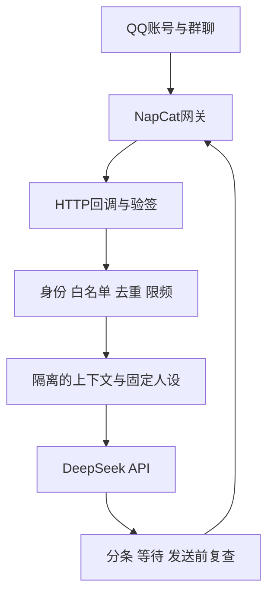

# 06 · 架构与实现

## 数据路径

QQ客户端由NapCat接入。NapCat将array格式事件通过本机反向HTTP送到8765；业务验签、筛白名单、去重、限频后调用模型，再通过本机3000的OneBot接口发送消息。

## 事件

接收message、message_sent与notice.notify.poke。来源账号必须匹配机器人配置。外部聊天数据不具备改配置权限；模型不能直接选择任意文件路径或系统命令。

回调按原始body验HMAC-SHA1，支持受限chunked读取。日志不写入消息全文或Key。

## 上下文

SQLite的context_history按conversation/user为联合主键。最多30个完整问答对、24000字符，先删最早的完整对话，不留下孤立assistant消息。基于最后保存时间，闲置24小时后失效；最多256个会话。当前不是长期用户画像、语义检索或自动摘要系统。

余额、签名/空间控制、思考开关、人设修改拒绝等管理路径不写入普通上下文。/清空清除当前key，不影响其他人的会话。

## 思考与联网

普通模式thinking disabled、max_tokens 1024。开启思考时最终请求thinking enabled、reasoning_effort high、max_tokens 8192、180秒超时；只使用content字段给QQ。

联网每轮最多一次搜索、4个结果。启用思考与联网时，先用短普通请求选择搜索；最终思考请求不带tools，把本轮结果标为参考资料。这样不需要把历史reasoning_content长期保存。这里仍可能有额外模型请求，不等同于本地免费推理。

## 发送与接话

2–4秒首条等待、1.5–3秒条间等待、最多6条。短闲聊可按行发气泡，代码和块公式作为完整单元。发送失败不自动重试，以免重复消息。

群内跟随窗口只给刚被直接回复的同一提问者，60秒内还要识别承接或疑问；显式@其他人、引用其他消息不套用该窗口。引用机器人消息按同群已发message_id匹配，最多回看10分钟的公开片段。其他私聊不进入引用上下文。

## 固定人设的边界

程序没有聊天改写人设接口；固定系统提示每轮重建，源码安装为444只读。但是提示词只能约束模型行为，不能从数学上保证模型对任意诱导都表现完全一致。权限、账号判断和工具白名单由代码实施。

## 状态文件

- config.json：账号、Key、Token与功能配置。
- quota.sqlite：每日额度、对话上下文、思考偏好与写入去重状态。
- balance-watch-state.json：低余额周期提醒标记。
- private-greeting-state.json：问候次数和上次发送时间。

以上文件均属于服务器私密运行数据，不属于GitHub源码或示例素材。
